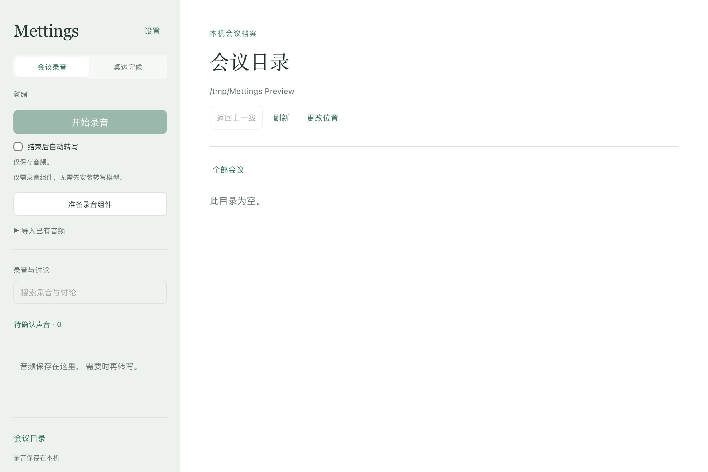
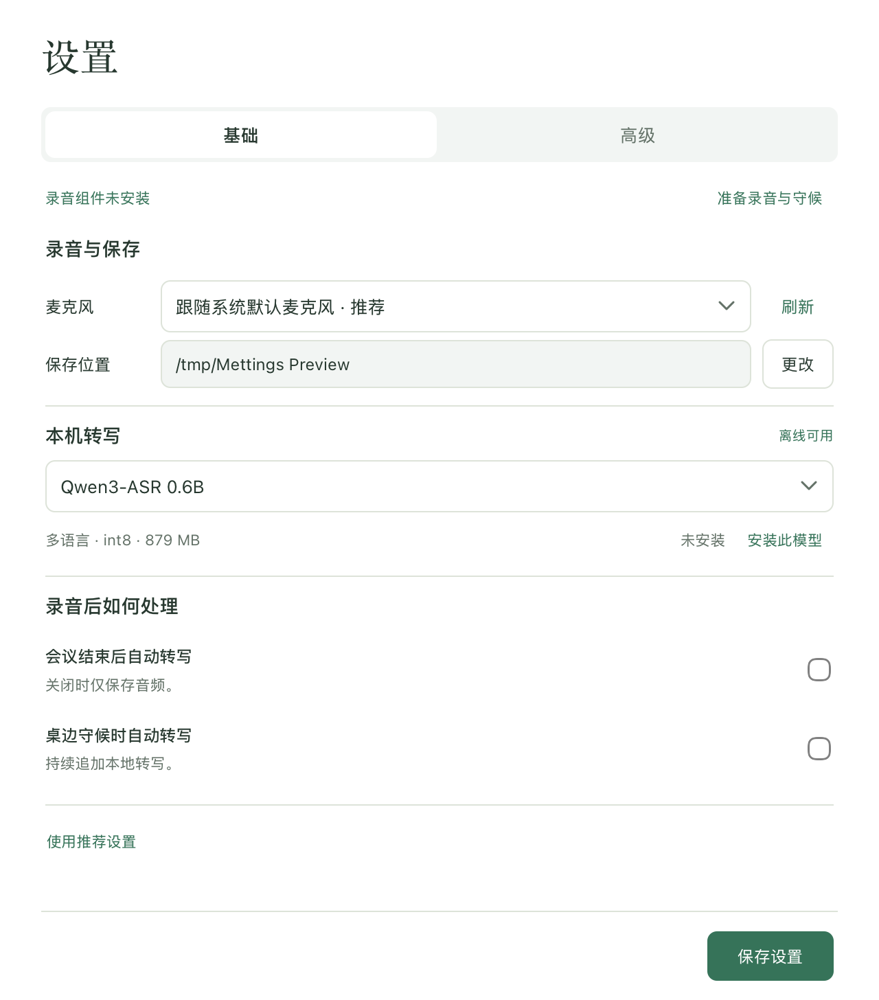

<div align="center">
  
  <h1>Mettings</h1>
  <p>Record meetings on your Mac, then transcribe and organize them at your own pace.</p>
  <p><a href="README.md">简体中文</a> · English</p>
  <p><a href="https://github.com/Wake-C/mettings/releases/latest">Download Mettings</a></p>
</div>



Mettings is a macOS app for recording and transcribing meetings. Recordings stay on your Mac. You can record first and choose a transcription model later, or import existing audio. Speech recognition runs locally by default, and transcription and voice labeling work offline once the required components are installed.

## Install

v0.2.0 requires macOS 15 or later and Apple Silicon (arm64). Download the [latest release](https://github.com/Wake-C/mettings/releases/latest), drag Mettings into Applications, and open it from the stable path `/Applications/Mettings.app`. macOS will request microphone access when you first record.

The release is signed with a persistent self-signed certificate, not notarized by Apple. If macOS blocks the first launch, open System Settings, go to Privacy & Security, and choose Open Anyway for Mettings. There is no need to disable Gatekeeper; macOS may still ask for confirmation or privacy permissions.

## Record and organize

- **Meeting recording** creates a folder when recording starts and saves the audio when you finish. Automatic transcription is off by default and can be changed before finishing. File and audio URL imports follow the Meeting automatic transcription setting. Audio-only recording needs FFmpeg, but not a speech model.
- **Desk mode** is an opt-in way to capture unplanned conversations. It retains detected speech with short surrounding buffers, rather than long stretches of quiet ambience. Pause closes the microphone and saves the last detected speech; Desk mode does not start at login or restart after a crash. Quiet speech may be missed, and nearby voices or playing video may be retained. An interruption can lose the unfinished in-memory clip; saved clips remain playable.
- Each mode remembers its own automatic transcription setting, both off by default. Desk automatic transcription uses local models only and does not hold up recording. Later, a saved recording can be transcribed with another local model or a configured online service.
- Each transcription attempt has its own version. A failure or a result with no text leaves previous successful transcripts readable. Retrying a failed attempt uses its original model and settings.
- Search, browse and play recordings in the app, read transcripts, label speakers and reuse confirmed voices. Voice matches are suggestions and can be corrected. Configure an online service to generate titles, or edit correction dictionaries and speaker aliases.

Closing a window does not stop recording. Quitting asks before stopping active work. See [Recording modes](docs/recording-modes.md) for details.

## Models and privacy

New installations select local Qwen3-ASR 0.6B by default, with automatic transcription off. Settings also offers SenseVoice, FireRedASR2-AED and Qwen3-ASR 1.7B. Models are downloaded as needed; components including FFmpeg, CAM++ and Pyannote are shared between models. Larger models need more storage and memory. The installer checks pinned SHA-256 hashes; see `local_models.go` and [NOTICE](NOTICE) for model and component sources.

<details>
<summary>Explore model and recording settings</summary>



</details>

In local mode, audio stays on your Mac and transcription and voice labeling work offline. Optional OpenAI-compatible transcription services and Volcengine SeedASR receive the selected audio. FireRedASR2-LLM requires a separately deployed compatible service and is not a bundled local model. If online title generation is enabled, the service receives transcript excerpts. Service credentials are stored in macOS Keychain.

The default recording folder is `~/Documents/mettings`. If `~/Documents/metting` already exists, a new configuration uses that folder instead. Obtain participants' consent before recording, and keep the microphone's status in mind in shared spaces.

## Build from source

You need Go 1.27.3 and Xcode Command Line Tools. Neither building nor running the app requires Python. The build script downloads pinned native dependencies and packages an Apple Silicon app, using ad hoc signing by default:

```sh
./scripts/build.sh
open build/Mettings.app
```

Set `METTINGS_GO` if Go is not on PATH. To create a release with a persistent self-signed certificate:

```sh
METTINGS_SIGN_IDENTITY='Mettings Local Release' ./scripts/release.sh
```

See [Release signing](docs/signing.md) for certificate setup, update identity and macOS limitations. Run `./scripts/test.sh` for Go race checks and frontend state tests.

## License

[MIT](LICENSE). See [NOTICE](NOTICE) for third-party component provenance and licenses.
