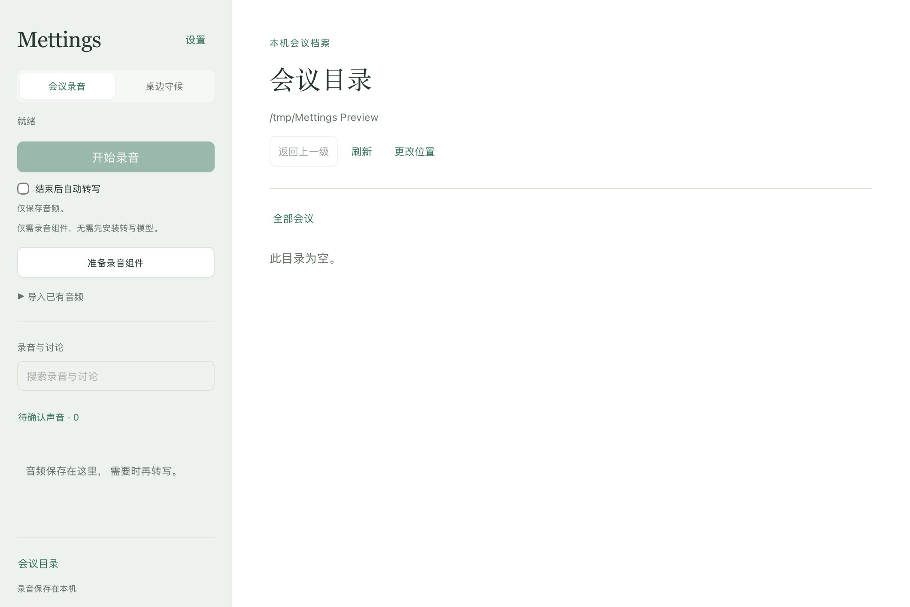
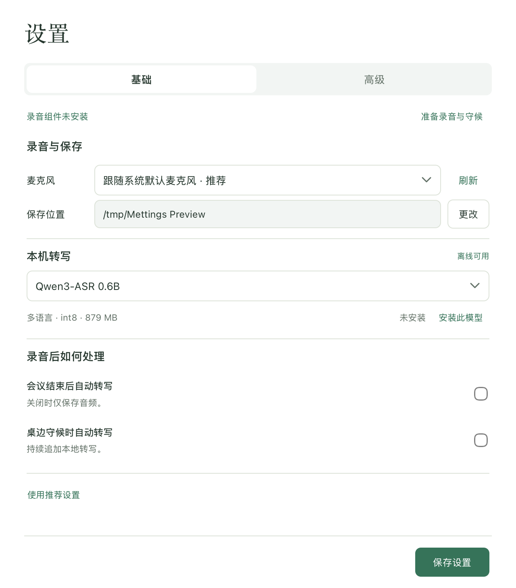

<div align="center">
  
  <h1>Mettings</h1>
  <p>在 Mac 上录下会议，按自己的节奏转写和整理。</p>
  <p>简体中文 · <a href="README.en.md">English</a></p>
  <p><a href="https://github.com/Wake-C/mettings/releases/latest">下载 Mettings</a></p>
</div>



Mettings 是一款 macOS 会议录音和转写 App。录音保存在本机，可以先录音、稍后选择模型转写，也可以导入已有音频。默认使用本地语音识别，安装所需组件后可离线转写和识别声音。

## 安装

v0.2.0 需要 macOS 15 或更新版本及 Apple Silicon（arm64）。从[最新版本](https://github.com/Wake-C/mettings/releases/latest)下载，将 Mettings 拖入「应用程序」文件夹，并从固定路径 `/Applications/Mettings.app` 打开。首次录音时，macOS 会请求麦克风权限。

发布包使用持久的自签名证书签名，未经 Apple 公证。如果首次打开被阻止，可前往「系统设置」中的「隐私与安全性」，找到相关提示并选择「仍要打开」。无需关闭 Gatekeeper；系统仍可能要求确认或请求隐私权限。

## 录音与整理

- **会议录音**从开始录音时创建目录，结束后保存音频。自动转写默认关闭，可在结束前更改。导入本地文件或音频链接时沿用会议录音的自动转写设置。仅录音需要 FFmpeg，不必先下载语音模型。
- **桌边守候**适合主动开启后记录临时交谈。它保留检测到的语音及前后短暂片段，不保存长时间的安静环境音。暂停会关闭麦克风并保存最后的语音；它不会随登录或崩溃后自动启动。安静的说话可能被漏掉，附近的人声或播放的视频也可能被保留。意外中断时，尚在内存中的片段可能丢失，已保存的片段仍可播放。
- 两种模式分别记住自动转写选择，默认均为关闭。桌边守候的自动转写只使用本地模型，录音不会等待转写完成。之后可对保存的录音选择其他本地模型或已配置的在线服务。
- 每次转写都有独立版本。失败或没有识别出文字时，之前成功的转写仍可查看；重试失败任务会沿用该任务原有的模型和设置。
- 在 App 中搜索、浏览和播放录音，查看转写稿，标注说话人并复用已确认的声音。声音匹配是建议，可以手动修正。可配置在线服务生成标题，也可以编辑纠错词典和说话人别名。

关闭窗口不会停止录音，退出 App 时会先确认是否停止正在进行的工作。完整说明见[录音模式](docs/recording-modes.md)。

## 模型与隐私

新安装默认选择本地 Qwen3-ASR 0.6B，自动转写关闭。设置中还可选择 SenseVoice、FireRedASR2-AED 或 Qwen3-ASR 1.7B。模型按需下载，FFmpeg、CAM++ 和 Pyannote 等组件可在模型间复用；较大的模型需要更多存储和内存。安装器校验固定的组件 SHA-256，下载来源和模型信息见 `local_models.go` 与 [NOTICE](NOTICE)。

<details>
<summary>查看模型与录音设置</summary>



</details>

本地模式下，音频留在 Mac 上，转写和声音标注不需要联网。可选的 OpenAI 兼容转写服务和火山引擎 SeedASR 会接收所选音频；FireRedASR2-LLM 需要另行部署兼容服务，不是随 App 提供的本地模型。启用在线标题生成时，服务会收到转写片段。服务密钥存储在 macOS 钥匙串中。

默认录音目录为 `~/Documents/mettings`；如果已有 `~/Documents/metting`，新配置会沿用该目录。请在录音前取得参与者同意，并留意共享环境中的麦克风状态。

## 从源码构建

需要 Go 1.27.3 和 Xcode Command Line Tools，构建及运行均不需要 Python。构建脚本下载固定版本的原生依赖并打包 Apple Silicon App，默认使用 ad hoc 签名：

```sh
./scripts/build.sh
open build/Mettings.app
```

如果 Go 不在 PATH 中，可设置 `METTINGS_GO`。使用持久自签名证书制作发布包：

```sh
METTINGS_SIGN_IDENTITY='Mettings Local Release' ./scripts/release.sh
```

证书创建、更新身份与系统限制见[发布签名](docs/signing.md)。运行 `./scripts/test.sh` 可执行 Go race 检查和前端状态测试。

## 许可证

[MIT](LICENSE)。第三方组件来源及许可见 [NOTICE](NOTICE)。
